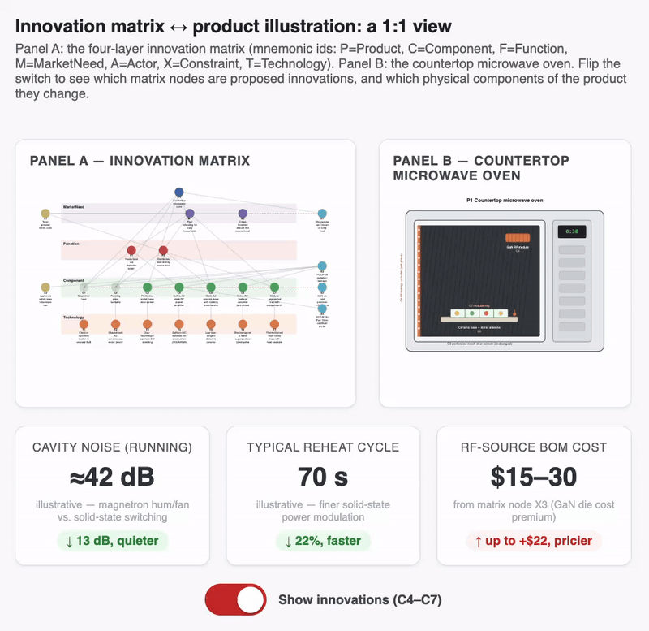
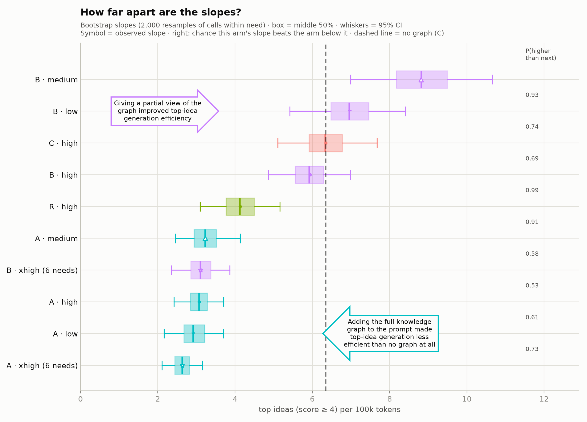
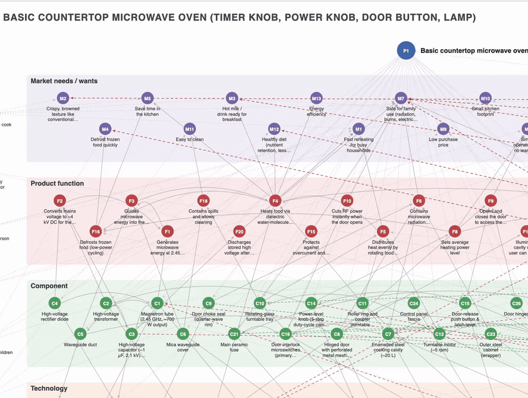

# AI brainstorming: Is less context more?

### Explore the product graph



# Is less more? Narrow context in LLM ideation with product graphs

Code, data and paper for **"Is less more? Narrow context is more efficient than full context for generative ideation with product graphs"**.

A hand-built innovation matrix of a microwave oven (123 nodes, 246 typed edges) is given to `claude-haiku-5-5` in four forms:

| Condition                      | What the prompt contains                      |
| ------------------------------ | --------------------------------------------- |
| **A**, full graph        | the whole innovation matrix                   |
| **B**, market-need slice | the vertical slice for the target market need |
| **R**, random slice      | a random slice of the same size as B          |
| **C**, no graph          | the product and the market need only          |

The model applies the SUBSTITUTE operator to 13 market needs at four levels of thinking effort (580 calls, 2,892 ideas). `claude-sonnet-5-5` judges the ideas blind, both as whole sets (pairwise) and one by one. The main measure is **yield**: top ideas (score ≥ 4.0, the top 12%) per 100k tokens.

**Main result.** The market-need slice at medium effort yields 8.8 top ideas per 100k tokens, about three times the full graph at any effort, and beats it on 10 of 13 market needs. Per token, the full graph is less efficient than no graph at all.



*Top ideas per 100k tokens for each arm (box = middle 50% of 2,000 bootstrap slopes). Arms left of the dashed line, including every full-graph arm, find top ideas less efficiently than giving the model no graph at all.*



## Repository layout

| Path                                                               | Contents                                                                                          |
| ------------------------------------------------------------------ | ------------------------------------------------------------------------------------------------- |
| `microwave_base_graph.yaml`                                      | the innovation matrix (product graph)                                                             |
| `slicer.py`, `slices/`                                         | market-need slices (B) and size-matched random slices (R), with `manifest.csv`                  |
| `template_prompt.txt`                                            | the generation prompt                                                                             |
| `KG_informed_brainstorm_AB_Test.py`                              | runs the generation calls                                                                         |
| `analyze.py`                                                     | pairwise set judging and summaries                                                                |
| `top_ideas.py`                                                   | individual idea scoring (quality; `--rubric patent` for patentability) and the ranked idea list |
| `charts.py`, `tail_charts.py`, `figure_innovation_matrix.py` | figures                                                                                           |
| `human_check.py`                                                 | stratified sample for human raters, and agreement statistics                                      |
| `runs/`                                                          | every generation call (prompt metadata, raw response, token counts)                               |
| `results/`                                                       | judge outputs, tables, charts, results write-up                                                   |
| `persona_as_factor/`                                             | exploratory follow-up: three personas × B, C × 3 market needs × 2 efforts                      |
| `paper/`                                                         | LaTeX source of the paper (`main.tex`; built from Markdown drafts by `build_paper.py`)        |

## Reproducibility

### Pipeline overview

```text
  microwave_base_graph.yaml
             │
             ▼ slicer.py
     slices/*.yaml + manifest.csv
             │
             ▼ KG_informed_brainstorm_AB_Test.py  [Claude Haiku 5.5]
       runs/rq1_full.jsonl (580 calls, 2,892 ideas)
        /               \
       /                 \
      ▼ analyze.py judge  ▼ top_ideas.py score  [Claude Sonnet 5.5]
 results/judgments.jsonl  results/idea_scores.jsonl
      │                   │
      ▼ analyze.py summary▼ top_ideas.py report
 results/pairwise_*.csv   results/ideas_ranked.csv
      │                   │
      └─────────┬─────────┘
                ▼ charts.py, tail_charts.py, persona_analysis.py
          results/charts/*.png  ──>  paper/main.pdf (LaTeX build)
```

### 1. Environment setup

```bash
python3 -m venv .venv
source .venv/bin/activate
pip install -r requirements.txt
```

### 2. Offline reproduction (no API key needed)

All raw generation logs and judge outputs are included in `runs/` and `results/`. You can recalculate every statistic, summary table, chart, and compile the manuscript completely offline:

```bash
# 1. Regenerate slices and manifest
python slicer.py microwave_base_graph.yaml

# 2. Cost, validity, pairwise statistics, and idea rankings
python analyze.py stats --logs runs/rq1_full.jsonl
python analyze.py summary --logs runs/rq1_full.jsonl
python top_ideas.py report --logs runs/rq1_full.jsonl

# 3. Top-tail metrics, yield slopes, and bootstrap intervals
python tail_charts.py --threshold 4.0
python tail_charts.py --threshold 4.25
python tail_charts.py --match-needs

# 4. Figures and charts
python figure_innovation_matrix.py
python figure_slices_grid.py
python charts.py
python tail_charts.py
(cd persona_as_factor && python persona_analysis.py)

# 5. Compile the paper PDF
python3 .github/skills/build_paper/build_paper.py
```

### 3. Live generation and scoring (requires API key)

To re-run generation or live LLM judging from scratch, export your Anthropic API key:

```bash
export ANTHROPIC_API_KEY=...          # never commit this

# 1. Inspect prompts without calling the API
python KG_informed_brainstorm_AB_Test.py --dry-run

# 2. Generation (Claude Haiku 5.5; ~8.6M tokens for full 580 calls)
python KG_informed_brainstorm_AB_Test.py --conditions A B R C --effort low medium high \
       --reps 5 --max-tokens 48000 --out runs/rq1_full.jsonl

# 3. Pairwise set judging (Claude Sonnet 5.5)
python analyze.py judge --logs runs/rq1_full.jsonl --pair condition A B --both-orders
python analyze.py judge --logs runs/rq1_full.jsonl --pair condition B R --both-orders
python analyze.py judge --logs runs/rq1_full.jsonl --pair condition B C --both-orders

# 4. Individual idea quality scoring (Claude Sonnet 5.5)
python top_ideas.py score --logs runs/rq1_full.jsonl
```

## Citation

Paper under submission; preprint link to follow.

## License

[To be chosen: for example MIT for the code, and CC BY 4.0 for the data and paper.]
