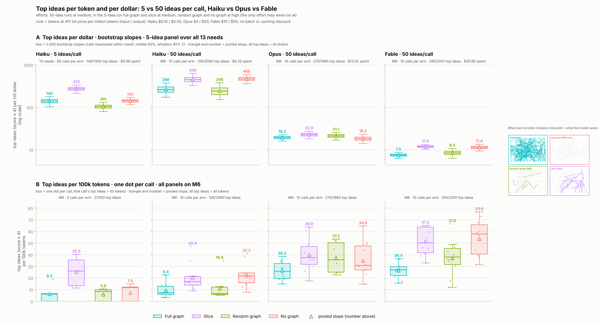

# AI brainstorming: Is less context more?

### Explore the product graph


# Is less more? Narrow context in LLM ideation with product graphs

Code, data and paper for **"Is less more? Narrow context is more efficient than full context for generative ideation with product graphs"**.

A hand-built innovation matrix of a microwave oven (123 nodes, 246 typed edges) is given to `claude-haiku-5-5` in four forms:

| Condition                      | What the prompt contains                      |
| ------------------------------ | --------------------------------------------- |
| **A**, full graph        | the whole innovation matrix                   |
| **B**, market-need slice | the vertical slice for the target market need |
| **R**, random slice      | a random slice of the same size as B          |
| **C**, no graph          | the product and the market need only          |

The model applies the SUBSTITUTE operator to 13 market needs at four levels of thinking effort (580 calls, 2,892 ideas). `claude-sonnet-5-5` judges the ideas blind, both as whole sets (pairwise) and one by one. The main measure is **yield**: top ideas (score ≥ 4.0, the top 12%) per 100k tokens.

**Main result** (5 ideas per call, Haiku). The market-need slice at medium effort yields 8.8 top ideas per 100k tokens, about three times the full graph at any effort, and beats it on 10 of 13 market needs. Per token, the full graph is less efficient than no graph at all.


*Top ideas per 100k tokens for each arm (box = middle 50% of 2,000 bootstrap slopes). Arms left of the dashed line, including every full-graph arm, find top ideas less efficiently than giving the model no graph at all.*

## Follow-up experiment: 50 ideas per call, three models

Asked for 5 ideas, the model mostly returns the same few obvious answers whatever it is given, so the
main study may only measure its first answers. The follow-up (`M6_50ideas/`) forces it past them.

**Design.**

| Factor | Level |
| --- | --- |
| Market need | one: M6, *simple operation with no learning curve*, chosen by pre-set rules (no overlap with the prompt's worked example, every arm found a top idea in the main study, arms ranked as in the pooled result) |
| Context | the same four conditions and files as the main study: A full graph, B need slice (28 nodes), R random slice of the same size, C no graph |
| Ideas per call | **50** (main study: 5); everything else in the prompt is identical, checked by `M6_50ideas/check_prompts.py` |
| Calls | 10 per condition, 40 per model, in random order |
| Effort | medium |
| Generator | `claude-haiku-5-5` (pre-registered run, 2026-10-19), repeated with `claude-opus-5-5` and `claude-fable-5-1` (added afterwards, exploratory) |
| Judge | `claude-sonnet-5-5` with the main study's prompt and criteria, blind to condition and position; each 50-idea list is judged in requests of 5 consecutive ideas, so every request looks like a main-study request |

**Measures.**

- **Yield**, as in the main study: top ideas (score ≥ 4.0) per 100k tokens, input + output, with a 95%
  bootstrap CI over calls.
- **Yield per dollar:** each call's tokens at the API list price (USD per million input / output
  tokens: Haiku $0.10 / $0.50, Opus $4 / $20, Fable $10 / $50; no batch or caching discount).
- **Distinct ideas** (pre-registered H12–H15, Haiku run; coding in progress): each idea is coded into a
  *move*, defined by what it replaces and by what, using a codebook built beforehand from the main
  study's 250 M6 ideas. This measures how many different ideas each condition reaches, whether the
  later ideas stay on the need, and whether the first five ideas are the main study's usual five.

**Result so far.** The full graph was the least efficient condition for every model, at about half the
yield of the alternatives. The need slice and no graph were indistinguishable for every model. For
Opus and Fable the full graph did not lower the share of top ideas; it only cost more tokens. Stronger
models found up to twice as many top ideas per token, but Haiku found 20–40 times more per dollar.

| Top ideas per 100k tokens (per $) | Haiku 5.5 | Opus 5.5 | Fable 5.1 |
| --- | --- | --- | --- |
| Full graph | 9.4 (266) | 26.3 (19.3) | 26.4 (7.5) |
| Need slice | 20.4 (459) | 39.9 (22.9) | 51.3 (11.9) |
| Random slice | 10.9 (246) | 37.2 (21.1) | 37.0 (8.5) |
| No graph | 22.2 (468) | 34.8 (18.2) | 53.6 (11.4) |



*(A) Top ideas per US dollar at list price (log scale): bootstrap boxes, the uncertainty of each
condition's average yield (box = middle 50%, whiskers = 95% CI); the 5-idea panel pools all 13 needs.
(B) Top ideas per 100k tokens, M6 only: one dot per call, the call-to-call variation (whiskers 1.5 ×
IQR). Triangle and number = pooled yield. The 50-idea ideas are shorter and scored lower, so compare
conditions within a panel rather than heights across the 5-idea and 50-idea panels.*

Details, hypotheses and every step: [`M6_50ideas/README.md`](M6_50ideas/README.md).


## Repository layout

| Path                                                               | Contents                                                                                          |
| ------------------------------------------------------------------ | ------------------------------------------------------------------------------------------------- |
| `microwave_base_graph.yaml`                                      | the innovation matrix (product graph)                                                             |
| `slicer.py`, `slices/`                                         | market-need slices (B) and size-matched random slices (R), with `manifest.csv`                  |
| `template_prompt.txt`                                            | the generation prompt                                                                             |
| `KG_informed_brainstorm_AB_Test.py`                              | runs the generation calls                                                                         |
| `analyze.py`                                                     | pairwise set judging and summaries                                                                |
| `top_ideas.py`                                                   | individual idea scoring (quality; `--rubric patent` for patentability) and the ranked idea list |
| `charts.py`, `tail_charts.py`, `figure_innovation_matrix.py` | figures                                                                                           |
| `human_check.py`                                                 | stratified sample for human raters, and agreement statistics                                      |
| `runs/`                                                          | every generation call (prompt metadata, raw response, token counts)                               |
| `results/`                                                       | judge outputs, tables, charts, results write-up                                                   |
| `M6_50ideas/`                                                    | follow-up: 50 ideas per call on market need M6, four conditions × three models (Haiku, Opus, Fable), yield per token and per dollar, move coding |
| `paper/`                                                         | LaTeX source of the paper (`main.tex`; built from Markdown drafts by `build_paper.py`)        |

## Reproducing

```bash
pip install -r requirements.txt
export ANTHROPIC_API_KEY=...          # never commit this

# 1. inspect the prompts without calling the API
python KG_informed_brainstorm_AB_Test.py --dry-run

# 2. generate (example: the high-effort arms)
python KG_informed_brainstorm_AB_Test.py --conditions A B R C --effort high --reps 5 \
       --max-tokens 48000 --out runs/rq1_full.jsonl

# 3. judge, score and summarise
python analyze.py judge  ...           # see python analyze.py --help
python analyze.py stats
python top_ideas.py score
python top_ideas.py report

# 4. figures
python charts.py
python tail_charts.py
python figure_innovation_matrix.py
```

Every number in the paper's results is regenerated from `runs/` and `results/` by steps 3 and 4. Re-running the generation produces new samples, so individual ideas will differ.

The follow-up runs from its own folder, one step at a time; `GEN_MODEL` picks the generator
(`haiku` by default, `opus`, `fable`):

```bash
cd M6_50ideas
bash run_all.sh prompts                       # dry run and prompt check
GEN_MODEL=opus bash run_all.sh generate       # 40 calls of 50 ideas
GEN_MODEL=opus bash run_all.sh score          # blind judge
GEN_MODEL=opus bash run_all.sh chart          # Figure 8 for this run
python compare_runs_chart.py                  # all runs side by side (--unit dollars for per dollar)
```

## Citation

Paper under submission; preprint link to follow.

## License

[To be chosen: for example MIT for the code, and CC BY 4.0 for the data and paper.]
